<p align="center">
  <a href="https://www.duvanmarin.dev">
    
  </a>
</p>

<p align="center">
  <a href="https://www.duvanmarin.dev"></a>
  <a href="https://www.tiktok.com/@tech.autopsy"></a>
  <a href="mailto:duvan.marinc10@gmail.com"></a>
</p>

## `>` whoami

```yaml
name:      Duván Marín
role:      Médico forense de software · Backend Engineer
stack:     [Go, Java, AWS, PostgreSQL, Kafka, Docker]
focus:     sistemas de alta concurrencia, microservicios y bases de datos que no se caen
side_ops:  Tech Autopsy — post-mortems de los fallos de software más caros de la historia
status:    disponible para consultoría / freelance
```

## `>` expediente tech autopsy

Cada video disecciona un incidente real de producción. Cada autopsia deja una herramienta open source para que no te pase a ti.

| caso | incidente | causa de muerte | antídoto |
| :--: | :-- | :-- | :-- |
| `#001` | **GitLab · 2017** | `rm -rf` en la base de datos de producción equivocada: ~6 h de datos perdidos | [**go-guard**](https://github.com/DesiAPG/tech-autopsy-gitlab-2017) · Go |
| `#002` | **Cloudflare · 2019** | una regex con backtracking catastrófico en el WAF: CPU casi al 100 % en todo el mundo, 27 min caídos | [**regex-guard**](https://github.com/DesiAPG/tech-autopsy/tree/main/autopsia/002-cloudflare-2019-regex) · Go |
| `#003` | **Cloudflare · LavaRand** | una pared de lámparas de lava como fuente extra de entropía: basta con que una fuente siga secreta | [**entropy-mix**](https://github.com/DesiAPG/tech-autopsy/tree/main/anatomia/003-cloudflare-lavarand) · Go |
| `#004` | **Cloudflare · Pingora** | tiraron NGINX y escribieron su propio proxy en Rust: −70 % CPU y −67 % memoria con el mismo tráfico | [**pool-bench**](https://github.com/DesiAPG/tech-autopsy/tree/main/diagnostico/004-cloudflare-pingora) · Go |
| `#005` | **Cloudflare · Quicksilver** | un log con secuencia lleva cada cambio a todo el planeta en ~2 s, y un hueco se detecta | [**qs-mini**](https://github.com/DesiAPG/tech-autopsy/tree/main/anatomia/005-cloudflare-quicksilver) · Go |
| `#006` | **Cloudflare · 2025** | un archivo de features duplicado y un `unwrap()`: la peor caída desde 2019 | [**config-gate**](https://github.com/DesiAPG/tech-autopsy/tree/main/autopsia/006-cloudflare-2025-feature-file) · Go |

```diff
- [ERROR] db1.cluster · rm -rf /var/opt/gitlab/postgresql/data
+ [ OK  ] go-guard · comando destructivo bloqueado: requiere aprobación de un segundo ingeniero
- [ERROR] waf.edge · regla .*(?:.*=.*) → CPU ≈100 % en todo el planeta
+ [ OK  ] regex-guard · ✖ comodines-seguidos: la regla no pasa el CI
```

## `>` procedimientos

| | procedimiento | qué hago | entrega |
| :--: | :-- | :-- | :-- |
| `01` | **Autopsia de arquitectura** | Reviso tu sistema como si ya se hubiera caído: puntos únicos de falla, cuellos de botella, permisos peligrosos y backups sin probar. | Informe + plan de acción |
| `02` | **Cirugía de base de datos** | Índices, planes de ejecución, particionado y caché. Queries de segundos a milisegundos bajo carga real. | Cambios + métricas antes/después |
| `03` | **Guardarraíles cloud · AWS** | Infraestructura como código, autoescalado, observabilidad y controles para que un error humano no tumbe producción. | IaC + runbooks |

→ **[Solicitar una autopsia](mailto:duvan.marinc10@gmail.com)**

## `>` stack

<p>
  
  
  
  
  
  
  
  
  
  
  
  
</p>

---

<p align="center">
  <code>$ echo "¿tu sistema necesita una autopsia antes de morir?"</code><br />
  <a href="mailto:duvan.marinc10@gmail.com"><b>duvan.marinc10@gmail.com</b></a> · <a href="https://www.duvanmarin.dev"><b>www.duvanmarin.dev</b></a>
</p>
